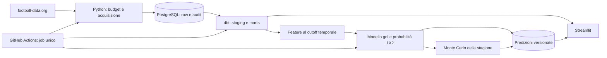

# Architettura e roadmap

## Obiettivo e confini della prima fase

Costruire un portfolio riproducibile che mostri acquisizione, modellazione SQL,
qualità, analisi e valutazione predittiva. La dashboard parte dal Brighton;
il dataset di base contiene **tutta la Premier League**. Un modello di forza
squadra e una simulazione della classifica richiedono anche avversarie e calendario
completo. La raccolta delle statistiche dettagliate può inizialmente limitarsi al Brighton.

Sono implementati i probe, la dashboard Streamlit, un backend FastAPI opzionale
e i relativi test. Il frontend usa un adapter con cache JSON locale e caricamento
su richiesta, oppure consuma gli endpoint FastAPI con la stessa cache condivisa.
PostgreSQL, dbt, orchestrazione e modelli sotto sono decisioni progettuali per
le milestone successive. [Dashboard implementata](dashboard.md).

Aggiornamento fonte, **13 ottobre 2026**: il probe API-Football ha rilevato il
diniego Free sul 2026/27. Il successivo probe football-data.org ha verificato
squadre, calendario, risultati e classifica per la stessa stagione; questo è
ora il provider dell'MVP. [Evidenze e limiti](football-data-discovery.md).
Le statistiche dettagliate per partita rimangono estensioni future: non sono
state verificate nel piano football-data.org e non bloccano il primo rilascio.

## Flusso previsto



Nell'architettura finale Streamlit leggerà il database con utente read-only e
cache. Nell'MVP attuale l'adapter legge l'API soltanto alla scadenza della cache
o al refresh esplicito, rispettando quota e cooldown. UI: filtro stagione, risultati e prossima gara, punti
cumulati, gol fatti/subiti, forma recente e split casa/trasferta. Grafici di
trend e distribuzioni predittive indicano campione, cutoff e ultimo aggiornamento.
Valori mancanti rimangono tali: niente conversioni implicite in zero.

PostgreSQL locale via Docker è la prima destinazione. GitHub Actions gestisce
subito i test offline; l'orchestrazione dei dati arriverà dopo la verifica della
fonte. Per una schedulazione cloud serve una destinazione PostgreSQL persistente
e raggiungibile: un servizio DB temporaneo nel runner non conserva lo storico.
Hosting e costi verranno scelti in quella fase, senza presupporre un servizio
cloud gratuito permanente o esporre il database locale su Internet.

## Repository futuro

Estendere l'attuale struttura solo quando una milestone richiede il componente:

```text
src/football_intelligence/
  api.py, probe.py        # già presenti; base da evolvere dopo discovery
  ingestion/             # estrazione, ledger condiviso, snapshot e caricamento
  quality/               # controlli fonte, freschezza e riconciliazione
  features/              # dataset storici point-in-time
  models/                # baseline, fit, inferenza, backtest
  simulation/            # calendario residuo e distribuzioni di classifica
dbt/
  models/staging/        # tipi, deduplica, normalizzazione stati
  models/intermediate/   # una riga per squadra e partita
  models/marts/          # dashboard e feature con cutoff
  tests/                 # integrità e riconciliazioni SQL
sql/migrations/          # schema operativo, ruoli, audit
app/                     # Streamlit: viste e componenti
tests/                   # unit, contract, integration e test temporali
docs/                    # decisioni, data dictionary, model card, runbook
notebooks/               # sola esplorazione riproducibile, logica nei moduli
```

Dipendenze introdotte per fase: driver PostgreSQL, `dbt-postgres`, poi
Streamlit, NumPy/pandas e scikit-learn. Separare ambiente dbt da quello app/ML
se necessario e congelare versioni dopo averne verificato compatibilità.
Segreti via ambiente e GitHub Secrets; `.env`, DB dump e payload raw fuori da Git.
Fixture di test sintetiche versionate; dati reali pubblicabili solo con permessi adeguati.

## Schema logico e granularità

| Area / tabella prevista | Granularità e chiavi | Uso |
| --- | --- | --- |
| `ops.ingestion_runs` | un'esecuzione, `run_id` | esito, versione codice, orari, conteggi |
| `ops.api_requests` | un tentativo, `request_id` | endpoint, parametri normalizzati, HTTP, quota, errore senza token |
| `ops.daily_budget` | provider/account e data UTC | prenotazione atomica con lock transazionale |
| `raw.api_responses` | risposta con `request_id`, `fetched_at` | JSONB immutabile, hash payload, lineage |
| `stg.teams` | provider + team ID | anagrafica e mapping futuri provider |
| `stg.season_teams` | league + season + team | partecipazione alla competizione |
| `stg.fixture_versions` | fixture ID + osservazione | kickoff, stato, squadre, punteggio, storico correzioni |
| `stg.fixture_statistics` | fixture + team + tipo + osservazione | valore tipizzato e unità; null ammesso |
| `stg.standings_snapshots` | league + season + snapshot + team | classifica e timestamp osservazione |
| `mart.team_matches` | fixture + team | gol, risultato, punti, casa/trasferta |
| `mart.team_season` | league + season + team + as-of | aggregati dashboard |
| `ml.features` | fixture + team + cutoff + versione | feature storiche e lineage |
| `ml.predictions` | fixture + cutoff + modello | lambda gol, 1X2, versione dati/training |
| `ml.season_simulations` | run + team + posizione | probabilità, seed e numero simulazioni |

Conservare `kickoff_at` (tempo dell'evento), `fetched_at`/`observed_at` (tempo
di acquisizione), eventuale `provider_updated_at` e `available_at` quando
dimostrabile. Non sovrascrivere silenziosamente punteggi o kickoff corretti.
Le viste correnti scelgono l'ultima osservazione valida; i backtest scelgono
la versione disponibile al cutoff. Gli ID sono sempre qualificati dal provider.

Idempotenza: una stessa risposta può essere deduplicata per hash ma ogni
tentativo conserva audit; upsert delle entità e commit atomico per batch.
Fallimenti parziali non promuovono il batch nei mart. dbt `source`/`ref`
esplicita le dipendenze e produce documentazione del lineage.

## Quota, aggiornamenti e qualità

Pianificare un unico batch giornaliero, senza livescore. Per football-data.org,
rispettare 10 chiamate/minuto; mantenere un limite locale prudenziale di 80
tentativi/giorno, che non è un limite contrattuale del nuovo provider.
Prima stima: calendario e classifica = circa 2 chiamate/giorno, con squadre e
metadati settimanali. Le metriche Brighton di base si derivano dai risultati.
Non è una promessa sui costi: pagine, retry, backfill e chiamate fallite entrano
nel ledger prima della richiesta. Le statistiche avanzate richiedono una fonte
separatamente verificata e un nuovo piano di consumo.

Cache dei metadati, risultati recenti ricontrollati per correzioni, backfill a
piccoli blocchi con checkpoint e priorità inferiore al refresh corrente.
Nessun ciclo su tutte le partite per statistiche dettagliate senza un piano di quota.
Il futuro client potrà gestire retry transitori limitati con backoff/Retry-After,
sempre prenotati nel budget; il probe attuale non fa retry.

Un workflow di orchestrazione futuro avrà `concurrency`, timeout, log redatti,
credenziali minime e ledger DB condiviso. Il cron GitHub Actions non va trattato
come un servizio con orario di avvio garantito: UI e pipeline controllano freschezza
e consentono recupero manuale. Nessuna schedulazione API viene attivata ora.

Controlli prima di rendere visibile un batch:

- Unicità delle chiavi, riferimenti squadre, casa diversa da ospite, tipi e stati validi.
- Gol interi non negativi per partite concluse; dati mancanti o stati intermedi
  non diventano sconfitte/pareggi. Rinvii e cancellazioni trattati esplicitamente.
- Due righe squadra per partita; GF di una squadra = GA dell'altra.
- Riconciliazione risultati/punti e aggregati; rettifiche disciplinari separate
  dal calcolo sportivo, senza sovrascrivere la classifica ufficiale.
- Calendario e partecipanti coerenti; eventuali conteggi attesi sono controlli
  di completezza a stagione definita, non errori obbligatori su calendario parziale.
- Null rate, freschezza, numero righe e anomalie rispetto all'ultima esecuzione.

## Modello gol e 1X2

Prima baseline: tassi di gol casa/trasferta del campionato. Secondo modello:
regressione di Poisson con attacco/difesa di squadra, vantaggio casa e
regolarizzazione; confrontare poi un'eventuale correzione Dixon-Coles.
Non partire da modelli complessi senza uno storico sufficiente.

Input ammessi: risultati conclusi antecedenti al cutoff, feature rolling con
esclusione della partita da prevedere, indicatori casa/trasferta e informazioni
note a quel momento. Training su tutte le squadre, gestione esplicita di neopromosse
e campioni piccoli con prior/shrinkage. Nessun uso di classifica finale, aggregate
odierne `/teams/statistics`, quote future o statistiche della partita target.

La matrice Poisson dei punteggi produce P(1), P(X), P(2) e gol attesi dal modello.
Usare una soglia di coda verificata o contabilizzare la massa residua, evitando
di perdere probabilità con un limite fisso sui gol. Le tre probabilità sommano a 1.
**I lambda Poisson non sono xG basati sui tiri**: UI e model card li distinguono.

Valutazione walk-forward per data/kickoff: training prima, validation dopo,
test finale mai usato nel tuning. Gare simultanee nello stesso blocco temporale;
fit di encoding, scaling e iperparametri soltanto sui fold di training.
Confronto con baseline mediante log-loss e Brier score multiclass, calibrazione
delle probabilità e devianza/log-likelihood dei gol. Salvare range di training,
cutoff, hash dati, versione codice, seed e metriche.

**Limite dello storico retrospettivo:** scaricare oggi una partita passata non
dimostra quando correzioni o statistiche fossero disponibili allora. Separare
backtest ricostruiti dai risultati (assunzioni e ritardo conservativo documentati)
da valutazioni rigorose basate su snapshot realmente raccolti prima del cutoff.
Non inventare timestamp di disponibilità uguali al kickoff. Test mirati proveranno
che aggiungere una gara futura non cambi le feature precedenti.

## Simulazione della posizione finale

Congelare un cutoff e conservare punti/risultati già acquisiti. Simulare soltanto
le partite residue di **tutte le squadre**, una sola volta per fixture e simulazione,
con risultati coerenti fra le due squadre. Campionare gol dalle distribuzioni
predittive, aggiornare punti/GF/GA e ordinare con le regole ufficiali della stagione.
Prima dell'implementazione verificare e versionare regolamento, spareggi e
rettifiche; i pari merito non risolti non possono essere ordinati arbitrariamente.

Rinviate e date TBD restano nel calendario residuo; calendario incompleto produce
una simulazione dichiarata parziale, non una classifica finale apparentemente certa.
Seed riproducibile, numero simulazioni configurabile (inizialmente 10.000),
controlli di convergenza e intervalli per probabilità stimate. Output: distribuzione
posizione, punti attesi, intervalli e probabilità obiettivi definiti esplicitamente.
Distinguere variabilità dei risultati da incertezza dei parametri: un primo modello
a parametri fissi non copre tutta l'incertezza. Non presentare la previsione come certezza.

## Roadmap con criteri di uscita

| Fase | Deliverable | Condizione prima di proseguire |
| --- | --- | --- |
| 0 — attuale | architettura, probe, test offline | report autenticato e decisione esplicita sulla fonte/stagione |
| 1 | PostgreSQL, audit, snapshot raw e caricamento manuale | replay idempotente e budget verificato |
| 2 | dbt staging/marts e data dictionary | controlli dati e riconciliazioni superati |
| 3 | Streamlit descrittivo Brighton | metriche tracciabili e missing/freschezza visibili |
| 4 | batch schedulato | persistenza, concorrenza, recupero e segreti verificati |
| 5 | baseline gol, modello e backtest | storico sufficiente, test anti-leakage, model card |
| 6 | Monte Carlo Premier League | calendario completo, regole verificate, convergenza |
| 7 | eventuale xG/xGA | fonte/licenza adeguata, mapping fixture, copertura e definizioni |

Ogni fase aggiunge README/runbook e test pertinenti. Non generare dati fittizi
per mascherare limiti della fonte nella dashboard: eventuali demo sintetiche
devono essere etichettate e separate dalle osservazioni reali.
